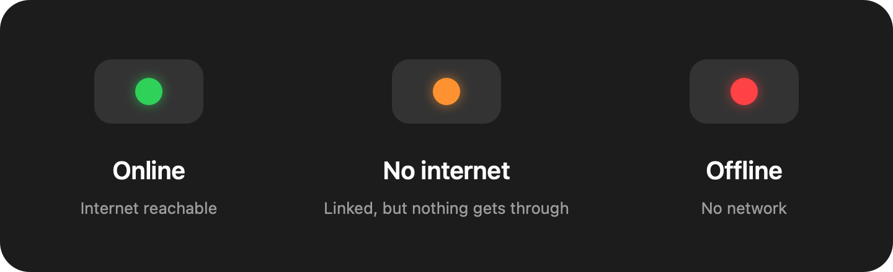

# MacCon

A tiny macOS menu bar app: a colored dot that shows whether you're actually online.



Click the dot for router, DNS, ping, and local IPv4/IPv6 details (click a row to copy it). There's also a **Launch at Login** toggle.

## Build

Requires macOS 14+ and the Swift toolchain (Xcode or Command Line Tools).

```sh
./build.sh        # creates MacCon.app
open MacCon.app
swift test        # run the tests
```

The app is ad-hoc signed (not notarized), so build it yourself rather than downloading a binary. If you do download one, right-click → Open the first time.

## Privacy

Every 10 seconds it fetches `gstatic.com/generate_204` and `apple.com/library/test/success.html`, and pings `1.1.1.1` when you open the details. Nothing else leaves your machine.

## License

MIT
